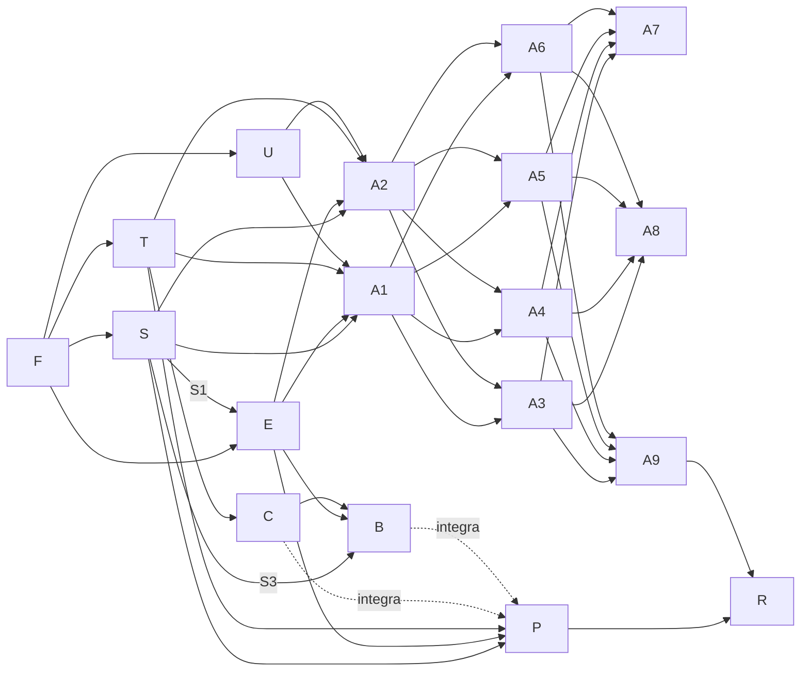

# 04 · Frentes de trabalho

Cada frente é executada por uma thread. Os briefs abaixo são autossuficientes: o coordenador pode passá-los direto. Toda thread lê antes `CLAUDE.md` e os documentos de `docs/plano/` citados no brief.

## 1. Mapa de frentes

| ID | Frente | Onda | Depende de | Pastas que é dona |
|----|--------|------|-----------|-------------------|
| F | Fundação | 1 | — | raiz (configs), `.github/`, `src/layouts/`, `src/styles/`, `src/components/`, `src/content.config.ts`, `src/pages/[modulo]/**`, `CLAUDE.md` (seção de comandos) |
| S | Motor de simulação | 2 | F | `src/engine/`, `tools/ngspice/` |
| E | Esquemático e instrumentos | 2 | F, contrato de S (S1 para integrar) | `src/circuit/`, `src/pages/dev/circuitos*` |
| T | Kit 3D | 2 | F | `src/three/`, `public/hdri/`, `public/textures/`, `src/pages/dev/pecas*` |
| U | Experiência do curso | 2 | F | `src/course/`, `src/content/trilhas/`, `src/pages/index.astro`, `src/pages/{modulos,trilhas,glossario,busca,progresso}/**` |
| C | Cenas reais 3D | 3 | T | `src/scenes/`, `public/models/`, `tools/blender/`, `src/pages/dev/cenas*` |
| B | Bancada interativa | 3 | S (S3), E, T, C (central) | `src/bench/` |
| P | Módulo do portão (M16) | 3 | S, E, T; integra C e B quando chegarem | `src/content/aulas/m16-*/`, `src/content/modulos/m16-*`, `src/lessons/m16/` |
| A1 | Conteúdo M00–M01 | 3 | S1, E, T, U | módulos citados (aulas, yaml, `src/lessons/mNN/`) |
| A2 | Conteúdo M02–M03 | 3 | S1, E, T, U | idem |
| A3 | Conteúdo M04–M05 | 4 | S2, E, T | idem |
| A4 | Conteúdo M06–M07 | 4 | S2, E, T, C (casa) | idem |
| A5 | Conteúdo M08 + M10 | 4 | S3, E, T | idem |
| A6 | Conteúdo M09 | 4 | S2, E, T | idem |
| A7 | Conteúdo M11–M12 | 5 | S3, E, T | idem |
| A8 | Conteúdo M13–M14 | 5 | S, E, T, C | idem |
| A9 | Conteúdo M15 + M17 | 5 | S3, E, T, C, B | idem |
| R | Revisão técnica e lançamento | 6 | todas | correções via PRs pequenos em qualquer pasta, combinadas com o coordenador |

S entrega em três PRs: **S1** (nível 1, linear + runtime), **S2** (nível 2), **S3** (nível 3, sistemas e portão).

## 2. Ondas e dependências

- **Onda 1:** F sozinha.
- **Onda 2 (4 em paralelo):** S, E, T, U. E trabalha contra o contrato e integra o motor real quando S1 entrar.
- **Onda 3 (5 em paralelo):** C, B, P, A1, A2. P começa pelo texto, pelos circuitos e pelo firmware da central e integra as cenas (C) e o exercício (B) quando chegarem. P vem cedo de propósito: é o caso que o Matheus vai usar de verdade.
- **Onda 4:** A3, A4, A5, A6.
- **Onda 5:** A7, A8, A9.
- **Onda 6:** R.

Sugestão: no máximo 5 threads de execução ao mesmo tempo. Uma frente de conteúdo pode começar antes da sua onda se as dependências já tiverem entrado.

## 3. Processo comum

- Uma branch e um PR por entrega; PRs pequenos o bastante para revisar (uma frente de conteúdo abre um PR por módulo).
- Antes de abrir o PR: `pnpm lint && pnpm typecheck && pnpm test && pnpm build && pnpm test:e2e`. O CI repete tudo.
- **Merge:** decisão pendente com o Matheus (ver README). Até lá, os PRs ficam prontos para revisão com CI verde.
- Dependências npm: a Fundação instala todas as previstas na arquitetura. Uma dependência nova precisa de justificativa no PR. Conflito em `pnpm-lock.yaml`: trazer a `main` e rodar `pnpm install`, nunca editar o lockfile à mão.
- Mudança no contrato do motor (`src/engine/contract.ts`) ou em arquivo de outra frente: combinar antes com o coordenador.
- Ao terminar, a thread informa na própria thread o que entregou, com link para a página ou galeria `/dev/` onde dá para ver.

---

## 4. Briefs

### F · Fundação

**Ler:** `CLAUDE.md`, `docs/plano/02-arquitetura.md` (seções 2, 3, 4, 5.2, 10, 11).

**Objetivo:** deixar o projeto pronto para as outras frentes trabalharem em paralelo sem pisar umas nas outras.

**Entregas:**
1. Projeto Astro 7 + React 19 + TypeScript estrito + MDX + Tailwind 4 + KaTeX (`remark-math`/`rehype-katex`) com pnpm. `base: '/eletrics-course'`, `site: 'https://matheusz-nied.github.io'`.
2. **Todas as dependências previstas** já instaladas: three, @react-three/fiber, @react-three/drei, @react-three/postprocessing, zustand, uplot, zod, pagefind, @vite-pwa/astro, @fontsource (Inter, JetBrains Mono), vitest, @playwright/test, @axe-core/playwright, eslint, prettier.
3. Scripts: `dev`, `build` (inclui Pagefind), `preview`, `lint`, `format`, `typecheck`, `test`, `test:e2e`.
4. Content collections com schemas zod de `modulos`, `aulas`, `glossario`, `trilhas` exatamente como na seção 4.1 da arquitetura.
5. Rotas `/<modulo>/` e `/<modulo>/<aula>/`; layouts Base, Módulo e Aula (sumário lateral, navegação anterior/próxima, objetivos no topo, aviso de segurança automático quando `seguranca: rede`, rodapé com espaço para o progresso). Design system com tokens claro/escuro, tipografia confortável para leitura longa, responsivo a partir de 360 px. Visual sóbrio e técnico, de produto premium, não de blog.
6. Componentes de conteúdo reais: `Callout`, `Figure`, `Steps`/`Step`, `DeepDive`, `RealCase`. **Stubs** com as props finais (renderizam "em construção") nos caminhos dos donos: `src/circuit/Simulation.astro`, `src/circuit/Plot.astro`, `src/three/Model3D.astro`, `src/scenes/Scene3D.astro`, `src/bench/WiringExercise.astro`, `src/course/Quiz.astro`, `src/course/Term.astro`, `src/course/Workshop.astro`. Mapa MDX em `src/components/mdx.ts`.
7. `src/engine/contract.ts` copiado da seção 5.2 da arquitetura.
8. Uma aula de exemplo (`src/content/aulas/m00-comece-aqui/00-exemplo.mdx`, `rascunho: true`, fora da navegação em produção) usando todos os componentes.
9. CI no GitHub Actions (lint, typecheck, test, build, e2e) e workflow de deploy no GitHub Pages a cada push na `main`. Pedir ao Matheus, na thread, para ativar **Settings → Pages → Source: GitHub Actions** quando o workflow estiver na `main`.
10. Página inicial provisória (a Experiência substitui), template de PR em `.github/pull_request_template.md` e seção "Comandos" do `CLAUDE.md` preenchida.

**Aceite:** `pnpm build` e todos os testes passam; a aula de exemplo abre no navegador sem erro de console; o site publicado abre em `https://matheusz-nied.github.io/eletrics-course/`.

**Fora do escopo:** implementação real de simulação, 3D, quiz e progresso.

---

### S · Motor de simulação

**Ler:** `docs/plano/02-arquitetura.md` (seção 5 inteira), `docs/plano/05-portao.md` (seção 5).

**Objetivo:** um motor de circuitos em TypeScript puro, preciso, estável e rápido o bastante para rodar em tempo real no navegador, com componentes que se comportam (e queimam) como os reais.

**Entregas em três PRs:**
- **S1:** formato e `buildNetlist`, `defineCircuit` com validação zod, solver MNA (LU densa), análise CC e transiente, dispositivos de nível 1, runtime em Web Worker com `SimHandle` completo, eventos de dano para `fuse`/`lamp`/`resistor`, golden tests contra ngspice (`tools/ngspice/`).
- **S2:** Newton-Raphson com `pnjlim` e gmin stepping; dispositivos de nível 2; varredura CA; danos de LED, diodo, transistor, capacitor eletrolítico.
- **S3:** modo quase-estático fasorial; dispositivos de nível 3, com destaque para `ac-motor-1ph-cap` (modelo físico de dois enrolamentos em quadratura), `mcu` com firmware por id, `gate-mechanics`, `reed-switch`, `photocell`, `rf-receiver`, `mains`, `jumper`, `dip-switch`, `trimpot`. Teste de sistema: o circuito de referência do portão (`05-portao.md`, seção 5) abre, para no fim de curso, fecha, reverte com a fotocélula e inverte quando ABRE/FECHA são trocados.

**Aceite:** precisão e desempenho da seção 5.4; cada dispositivo com teste; `getDeviceInfo` documenta pinos, parâmetros (rótulos pt-BR) e leituras; nenhum import de DOM fora de `runtime/`.

**Fora do escopo:** desenho de símbolos, interface.

---

### E · Esquemático e instrumentos

**Ler:** `docs/plano/02-arquitetura.md` (seções 4.3, 5.2, 5.3, 6).

**Objetivo:** transformar um `CircuitDoc` numa simulação viva e bonita na página, com corrente e tensão visíveis, controles e instrumentos.

**Entregas:**
1. `<Simulation>` real (substitui o stub): carrega o circuito pelo id, mostra o esquemático SVG, controles, botões play/pausa/reiniciar/velocidade, painel de leituras, mensagens de evento (ex.: "O LED D1 queimou: corrente de 85 mA, máximo 30 mA").
2. Símbolos IEC/ABNT para todos os tipos dos níveis 1–3 (`symbols/`, um arquivo por tipo, usando os pinos de `getDeviceInfo`).
3. Animação de corrente e cores de tensão; formatação pt-BR com prefixos de engenharia.
4. Instrumentos: visor de multímetro, osciloscópio de 2 canais, gráfico no tempo, Bode, `<Plot>`.
5. Áudio Web Audio (relé, zumbido, motor, fusível), desligado por padrão.
6. `<SimBinding>` para ligar leituras a uma cena 3D (`scene3d.bindings`), com layout "esquema+3d".
7. Galeria `/dev/circuitos` listando todos os circuitos de `src/lessons/**`.
8. Enquanto S1 não entra: desenvolver contra um motor falso que respeita o contrato; trocar pelo real assim que S1 estiver na `main`.

**Aceite:** funciona com mouse, toque e teclado; 60 fps num circuito de 30 elementos; testes e2e de interação (ligar chave, girar potenciômetro, ver leitura mudar).

---

### T · Kit 3D

**Ler:** `docs/plano/02-arquitetura.md` (seções 4.3, 7).

**Objetivo:** uma biblioteca de peças 3D fotorrealistas, paramétricas e animáveis pela simulação, além da infraestrutura de cena usada por todo o curso.

**Entregas:**
1. `core/`: palco com HDRI CC0 local, tons ACES/AgX, sombras de contato, N8AO, bloom seletivo, controles de órbita com toque, enquadramento automático, níveis de qualidade, criação/destruição do Canvas por visibilidade, pôster sem WebGL.
2. `materials/`: biblioteca PBR (seção 7.2).
3. `parts/` (cada uma com `meta`, anotações, explosão e, quando fizer sentido, corte): resistor (faixas pelo valor, 1/4 W a 5 W, SMD), potenciômetro, trimpot, capacitores (cerâmico, poliéster, eletrolítico com rótulo e versão estufada, capacitor de motor com rótulo µF/VCA), indutor, LED 3/5 mm (cores, brilho), diodo, zener, transistores TO-92 e TO-220 com dissipador, CIs DIP-8/14/18 e QFP, relé (tampa transparente opcional, armadura animável), fusíveis (vidro 5×20 com filamento que rompe, lâmina automotiva), chave, botão tátil, botoeira de parede, borne de parafuso 2/3 vias (parafusos animáveis), barra de pinos + jumper removível, DIP switch, conector KK/JST, reed switch, sensor Hall, transformador EI, pilhas AA/9 V, bateria automotiva, protoboard com trilhas reveláveis, fios e cabos (curvas, cores NBR: azul neutro, verde-amarelo terra), gerador de placa de circuito impresso a partir de layout (FR-4, máscara, serigrafia, trilhas, furos), lâmpada incandescente e LED, ímã, bobina/solenoide, motor CC pequeno, buzzer, LDR, NTC, display de 7 segmentos.
4. `instruments/`: multímetro digital (seletor rotativo com posições reais, visor dinâmico, bornes COM/VΩ/mA/10A, pontas com cabo), chave de teste neon, alicate amperímetro, osciloscópio com tela dinâmica, fonte de bancada, ferro de solda.
5. `fx/`: brilho, cor de corpo negro, fumaça, faíscas, linhas de campo, partículas de corrente, transição de explosão/corte.
6. `<Model3D>` real e galeria `/dev/pecas` com controles para todas as props.

**Aceite:** cada peça com dimensões reais; a galeria abre em celular intermediário a 30+ fps; peça simples abaixo de 300 KB gzip além do núcleo do three; testes e2e de montagem com screenshot.

**Fora do escopo:** cenas grandes (portão, quadro) e ligação de fios (bancada).

---

### U · Experiência do curso

**Ler:** `docs/plano/01-curriculo.md` (trilhas), `docs/plano/02-arquitetura.md` (seções 4, 9).

**Objetivo:** a experiência de curso: chegar, escolher um caminho, estudar, praticar, acompanhar o progresso, e usar no celular ao lado do equipamento.

**Entregas:**
1. Página inicial (o que é o curso, trilhas, módulos, continuar de onde parou), catálogo de módulos, páginas de trilha (com os YAML das 4 trilhas do currículo).
2. Progresso no `localStorage` (aula lida, quiz, nota), indicadores em módulo/trilha/início, página `/progresso` com exportar/importar.
3. `<Quiz>` real com os tipos `multipla`, `numerica`, `vf`, `ordenar`, `associar` e feedback por alternativa.
4. Glossário (`/glossario`) e `<Term>` com popover acessível; 30 termos iniciais de base.
5. Busca Pagefind em pt-BR (`/busca` e atalho no cabeçalho).
6. `<Workshop>` (modo oficina): passos grandes, foto/cena por passo, marcar como feito, retomar; PWA com cache offline das páginas visitadas e das páginas de oficina.

**Aceite:** tudo operável por teclado e leitor de tela; e2e cobrindo progresso, quiz e busca; Lighthouse PWA instalável.

---

### C · Cenas reais 3D

**Ler:** `docs/plano/02-arquitetura.md` (seção 7), `docs/plano/05-portao.md` (seções 2–4).

**Objetivo:** montagens 3D grandes, fiéis ao mundo real, que as aulas e a bancada usam. **Prioridade máxima para o portão.**

**Entregas (nesta ordem, um PR por item):**
1. **Central de portão genérica** (`scenes/central-portao/`): placa conforme `05-portao.md`, seção 3, com bornes serigrafados, fusível, fonte, relés, microcontrolador, receptor 433 MHz com antena, botão PROG, LEDs, trimpots, jumpers e DIP; props para estado dos LEDs, relés, jumpers, trimpots e fios conectados; pontos de ancoragem nomeados para cada borne (a bancada usa).
2. **Portão deslizante completo** (`scenes/portao-deslizante/`): muro, portão, trilho, motor com tampa removível, redutor coroa/sem-fim, pinhão, cremalheira, ímãs de fim de curso e sensor reed, central na caixa, capacitor, fotocélulas nos pilares com feixe visível, botoeira, controle remoto, disjuntor; props `gatePosition`, `motorRpm`, `beamBlocked`, `lockOpen`.
3. **Motor de portão explodido** (`scenes/motor-portao/`): carcaça, estator com enrolamentos, rotor gaiola, eixo, sem-fim, coroa, embreagem, desbloqueio, capacitor.
4. Variantes basculante e pivotante (mais simples).
5. **Casa:** quadro de distribuição (disjuntores, DR, DPS, barramentos, fiação), tomada NBR 14136 explodida, interruptores simples/paralelo em caixa 4×2, chuveiro explodido, ventilador de teto com capacitor, lâmpada com sensor de presença.
6. Carro (bateria, caixa de fusíveis, relé) e bancada de eletrônica (mesa, fonte, multímetro, osciloscópio, protoboard).
7. `<Scene3D>` real e galeria `/dev/cenas`.

**Aceite:** sem marcas ou logotipos; escala real; cena do portão abaixo de 3 MB e 30+ fps em celular intermediário; GLBs (se houver) reproduzíveis por script em `tools/blender/`.

---

### B · Bancada interativa

**Ler:** `docs/plano/02-arquitetura.md` (seção 8), `docs/plano/05-portao.md` (seções 3, 6, 7).

**Objetivo:** permitir que o aluno faça ligações reais com as mãos (virtuais) e veja as consequências calculadas pelo motor de simulação.

**Entregas:**
1. Formato de cenário (`ScenarioDoc`, com zod) e registro por `import.meta.glob('/src/lessons/**/scenarios/*.ts')`.
2. Interação 3D: arrastar ponta de fio até borne com encaixe, apertar/soltar parafuso, colocar/tirar jumper, DIP, trimpot, botões; desfazer; versão 2D acessível equivalente (lista de bornes e ligações por teclado).
3. Multímetro 3D com pontas que encostam em qualquer terminal e leem o motor (inclusive erros realistas de modo e borne).
4. Conversão das ligações em `CircuitDoc` e "Ligar disjuntor" → simulação → cena reage.
5. Regras de segurança do cenário (soltar fio com disjuntor ligado = choque, reinicia o passo).
6. Verificações com mensagens e dicas progressivas; `<WiringExercise>` real.
7. Cenário de demonstração simples (pilha, chave e lâmpada) em `src/bench/demo/`. O cenário do portão é escrito pela frente P usando este formato.

**Aceite:** funciona com mouse e toque; o cenário de demonstração e o cenário do portão (quando P entregar) passam nos testes e2e para ligação certa e para pelo menos três ligações erradas com consequência correta.

---

### P · Módulo do portão (M16)

**Ler:** `docs/plano/05-portao.md` inteiro, `docs/plano/03-guia-de-conteudo.md`, `docs/plano/01-curriculo.md` (M16 e Trilha Portão).

**Objetivo:** o módulo de referência do curso. Quem fizer a Trilha Portão deve conseguir trocar o motor e a central do próprio portão com segurança e entender cada ligação.

**Entregas:**
1. **Pesquisa** em manuais públicos de centrais comuns no Brasil (PPA, Garen, Rossi, Nice/Peccinin, Intelbras) para validar nomes de bornes, jumpers, trimpots, procedimentos de cadastro e valores típicos (resistência dos enrolamentos, capacitor). Registrar fontes em `src/lessons/m16/FONTES.md`. Marcas citadas só no texto, nunca no 3D.
2. Firmware da central genérica (`src/lessons/m16/firmware/central-generica.ts`) com a máquina de estados da seção 5.
3. Circuitos das aulas (`src/lessons/m16/*.circuit.ts`) e cenários da bancada (`src/lessons/m16/scenarios/`): troca da central e defeitos da seção 7.
4. As 9 aulas do M16 e o `<Workshop id="trocar-motor-portao">` com o passo a passo da seção 6.
5. Aula/anexo "Do genérico para a sua central": tabela de equivalência de serigrafias entre a central genérica e as marcas pesquisadas, com aviso de sempre seguir o manual do fabricante.
6. YAML do módulo e da Trilha Portão conferidos.

**Ordem sugerida:** texto + firmware + circuitos primeiro (dependem só de S/E/T); depois integrar cenas (C) e exercício (B) quando entrarem.

**Aceite:** checklist do guia de conteúdo; firmware com testes (abre, para no fim de curso, pausa, fecha, fotocélula reverte, timer de 40 s, comando durante movimento); cenário de troca de central passa nos testes da bancada.

---

### A1–A9 · Conteúdo por módulo

**Ler:** `docs/plano/03-guia-de-conteudo.md`, `docs/plano/01-curriculo.md` (módulos da frente), `docs/plano/02-arquitetura.md` (seção 4.3).

| Frente | Módulos |
|--------|---------|
| A1 | M00 Comece aqui, M01 Eletricidade do zero |
| A2 | M02 Circuitos CC, M03 Medições |
| A3 | M04 Passivos, M05 Magnetismo |
| A4 | M06 Corrente alternada, M07 Instalações |
| A5 | M08 Motores, M10 Fontes |
| A6 | M09 Semicondutores |
| A7 | M11 Digital, M12 Microcontroladores |
| A8 | M13 Sem fio, M14 Placas |
| A9 | M15 Diagnóstico, M17 Projetos |

**Objetivo:** escrever todas as aulas dos módulos, com simulações, 3D, casos reais e exercícios, seguindo o guia de conteúdo.

**Entregas por módulo (um PR por módulo):** YAML do módulo; todas as aulas do currículo; circuitos em `src/lessons/mNN/`; termos novos no glossário; componentes específicos de aula em `src/lessons/mNN/`. Se faltar um dispositivo no motor ou uma peça 3D, criar arquivo novo pela regra de extensão (ou pedir ao coordenador se for grande).

**Aceite:** checklist do guia de conteúdo em todas as aulas; nenhuma simulação com erro; páginas passam no e2e (abre sem erro de console, axe sem violação séria).

---

### R · Revisão técnica e lançamento

**Ler:** todo `docs/plano/`.

**Objetivo:** garantir que o curso publicado está correto, seguro, consistente e rápido.

**Entregas:** revisão técnica de cada módulo (precisão, segurança, ordem dos procedimentos, valores conferidos no simulador); consistência de termos e links internos; auditoria de acessibilidade e desempenho (Lighthouse, axe); teste da Trilha Portão de ponta a ponta no celular; lista de correções aplicada em PRs pequenos; página "Sobre o curso" e aviso legal de segurança. Relatório final na thread.
